# Sudo Capitalism

A little game that started as a school project.

The code was originally written (by me) in a homebrew language from my university as a project.
I then translated it into Java, but it wasn't that good.

This is now the second iteration of the game in Java.

The game is using [LibGDX](https://libgdx.com/) to run.

*No code from this repo has been written by AI, this project is human made :)*

## Class diagram

> [!NOTE]
> I try my best to keep the diagram updated along development, some things might be slightly out of date sometimes in it.

```mermaid
classDiagram
    
    class Game {
        <<Abstract>>
    }

    class Screen {
        <<interface>>
    }

    class Main {
        +gameState GameState
        +uiSkin Skin
        -backgroundColor Color
        -screenList Map~String, Screen~
        
        +getBackgroundColor() Color
        +getScreenList() Map~String, Screen~
        +create() void
    }

    class MainScreen {
        -Main main
        -Stage stage
        
        +MainScreen(Main)
        
        +show() void
        +render(float) void
        +resize(int, int) void
        +pause() void
        +resume() void
        +hide() void
        +dispose() void
    }

    class LoadScreen {
        -Main main
        -Stage stage
        
        +LoadScreen(Main)
        
        +show() void
        +render(float) void
        +resize(int, int) void
        +pause() void
        +resume() void
        +hide() void
        +dispose() void
    }

    class OptionsScreen {
        -Main main
        -Stage stage
        
        +OptionsScreen(Main)
        
        +show() void
        +render(float) void
        +resize(int, int) void
        +pause() void
        +resume() void
        +hide() void
        +dispose() void
    }
    
    class DebugScreen {
        -main Main
        -gameState GameState
        -stage Stage
        
        +DebugScreen(Main, GameState)
        
        +show() void
        +render(float) void
        +resize(int, int) void
        +pause() void
        +resume() void
        +hide() void
        +dispose() void
    }

    class GameScreen {
        -main Main
        -gameState GameState
        -stage Stage

        +GameScreen(Main, GameState)
        
        +show() void
        +render(float) void
        +resize(int, int) void
        +pause() void
        +resume() void
        +hide() void
        +dispose() void
    }

    class NewGameScreen {
        -main Main
        -gameState GameState
        -stage Stage

        +NewGameScreen(Main, GameState)

        +show() void
        +render(float) void
        +resize(int, int) void
        +pause() void
        +resume() void
        +hide() void
        +dispose() void
    }

    class Genre {
        FEMALE
        MALE
        UNSET
    }

    class Person {
        # String firstName
        # String lastName
        # int age
        # Genre genre
        +Person(String, String, int, Genre)
        +getFirstName() String
        +getLastName() String
        +getAge() int
        +getGenre() Genre
    }

    class Player {
        +Player(String, String, Genre)
        +Player()
        +setFirstName(String) void
        +setLastName(String) void
        +setGenre(Genre) void
    }
    
    class Worker {
        -double efficiency
        
        +Worker(String, String, int, Genre)
        +Worker(Person person)
        
        +getEfficiency() double
        +increaseEfficiency(double) void
        +decreaseEfficiency(double) void
    }

    class Company {
        -double money
        -String name
        -ArrayList<Worker> employees
        
        +Company()

        +getName() String
        +setName(String) void
        +getMoney() double
        +addMoney(double) void
        +spendMoney(double) void
        +getEmployees() ArrayList<Worker>
        +hire(Person) void
        +fire(Worker) void
    }

    class Economy {
        +Economy(Company) void
        +getPlayerCompany() Company
    }

    class Reputation {
        +Reputation(Company) void
        +getPlayerCompany() Company
    }
    
    class GameStateListener {
        <<interface>>
        +updateMoney(GameState) void
    }

    class GameState {
        private ArrayList~GameStateListener~ listeners
        private final Economy economy
        private final Reputation reputation
        private final Company playerCompany
        private final Player player
        +GameState()
        +addListener(GameStateListener) void
        +removeListener(GameStateListener) void
        +getPlayer() Player
        +getPlayerCompany() Company
        +notifyMoneyChanged() void
        +addMoney(double) void
    }

    class ConsumableType {
        FOOD
        DRINK
    }

    class Item {
        #name String
        #description String
        +Item(String, String)
        +Item(String)
        +getName() String
        +getDescription() String
    }

    class Consumable {
        +Consumable(String, String, ConsumableType, Effect) void
        +Consumable(String, ConsumableType, Effect) void
        +getConsumableType() ConsumableType
        +getEffect() Effect
    }
    
    class Effect {}

    Main --|> Game
    
    Main --> Screen : * -screenList
    Screen <|.. MainScreen
    Screen <|.. LoadScreen
    Screen <|.. OptionsScreen
    Screen <|.. DebugScreen
    Screen <|.. GameScreen
    Screen <|.. NewGameScreen
    
    Genre --> Person :  1 #genre
    Player <|-- Person
    Worker <|-- Person

    Company <-- Reputation : 1 -playerCompany
    Company <-- Economy : 1 -playerCompany

    GameStateListener --> GameState : * -listeners
    GameState --> Economy : 1 -economy
    GameState --> Reputation : 1 -reputation
    GameState --> Company : 1 -playerCompany
    GameState --> Player : 1 -player
    
    Main --> GameState : 1 -gameState

    Item <|-- Consumable
    Consumable --> ConsumableType : 1 #consumableType
    Consumable --> Effect : 1 #effect
```



## Features to be added
*This is a list I'll fill along development with ideas I have for the game.*

- [x] A storage system the needs to be upgraded in order to produce and sell more items
- [ ] Proper economy simulation

## Project structure

```
sudocapitalism
├── 📁 character
│   ├── Genre.java
│   ├── Person.java
│   ├── Player.java
│   └── 📁 worker
│       ├── InventoryManager.java
│       ├── MarketingManager.java
│       ├── ProductionManager.java
│       └── Worker.java
├── 📁 company
│   ├── Company.java
│   └── CompanyListener.java
├── 📁 gameState
│   ├── 📁 economy
│   │   └── Economy.java
│   ├── GameState.java
│   ├── GameStateListener.java
│   ├── 📁 production
│   │   ├── Production.java
│   │   ├── ProductionListener.java
│   │   └── Product.java
│   ├── 📁 reputation
│   │   └── Reputation.java
│   └── 📁 time
│       ├── Time.java
│       └── TimeListener.java
├── 📁 item
│   ├── 📁 consumable
│   │   ├── Consumable.java
│   │   └── ConsumableType.java
│   ├── Effect.java
│   ├── 📁 equipment
│   │   ├── clothing
│   │   └── tool
│   └── Item.java
├── Main.java
└── 📁 ui
    ├── 📁 game
    │   ├── 📁 dashboards
    │   ├── 📁 layout
    │   │   ├── MainScreenLayout.java
    │   │   ├── SideBar.java
    │   │   └── TopBar.java
    │   ├── MainScreen.java
    │   └── widgets
    │       └── ProductionWidget.java
    ├── 📁 menu
    │   ├── HomeScreen.java
    │   ├── LoadScreen.java
    │   ├── NewGameScreen.java
    │   └── OptionsScreen.java
    └── 📁 utils
        └── ColorWrapper.java
```

## Changelog

Builds:

<details open>
    <summary>PA-0.3</summary>

**v0.3.5**

- Doc added to `CapacityWidget`
- A notion of usage of the storage is being implemented.

**v0.3.4**

- Added a color check to make the progress bars more readable in case of a black background color.
- Multiple colors added to the theme.
- More buttons have been styled and now follow the background's color.

**v0.3.3**

- The inventory system has been replaced by a shared storage between all productions and managed by the Company.

**v0.3.2**

- Changed some esthetics of the UI.
- Modified the way new productions are visually added to the dashboard.

**v0.3.1**

- Doc added to `ProductionDashboard`.

**v0.3.0**

A big step has been done in terms of backend and UI.
- The production system is almost fully implemented.
- The UI is closer to its final form.

</details>

<details>
    <summary>PA-0.2</summary>

**v0.2.16**

- The changelog has been organized into version dropdowns.
- Added 📁 icons in the files tree to make it slightly more readable :)
- Doc added to `ProductionWidget`, `Main`, `Production`, `GameState`, `Product` and `ProductionListener`.

**v0.2.15**

- Changed the name of the `ProductionDashboard` to `ProductionWidget` as it's gonna be used as a Widget.
- Reduced the tree in the README file to only include source files stuff.

**v0.2.14**

- Multi-production system almost fully implemented.

**v0.2.13**

- Added some data to the game.
- Started moving towards a multi-production system.

**v0.2.12**

- Added a new way of representing a level with a progress bar.
- New inventory capacity system.

**v0.2.11**

- Doc added to the `Production` class.
- Some fixes.

**v0.2.10**

- Doc added to the `SideBar` class.

**v0.2.9**

- The UI has now been completely separated into smaller classes to make it easier to maintain.

**v0.2.8**

- The UI has been separated again to make it even easier to maintain in the future.
- Dedicated listeners are being added to some classes like `Production` or `Company` to make the code lighter.

**v0.2.7**

- Listeners are being separated to make the code easier to maintain.

**v0.2.6**

- The UI refactor has progressed with the `SideBar` class.

**v0.2.5**

- Replaced public attributes `main.uiSkin` and `main.backgroundColor` with proper getters and setters.

**v0.2.4**

- UI split in smaller tables to make it more modular.

**v0.2.3**

- The UI is undergoing a refactor to make it cleaner.
- A `TopBar` class has been added

**v0.2.2**

- The production leveling system is now working.

**v0.2.1**

- Added a base of the production system to the company.

**v0.2.0**

- Major code refactoring.
- Removed unnecessary listeners.

</details>

<details>
    <summary>PA-0.1</summary>

**v0.1.7**

- Changed the UI of the game.

**v0.1.6**

- Removed hardcoded values selection in the SelectBox of the `OptionsScreen` class for a dynamic approach.
- Added documentation to `ColorWrapper`, `CompanyListener` and `GameStateListener`.

**v0.1.5**

- The UI now uses [Raymond Buckley's Particle Park UI Skin](https://ray3k.wordpress.com/particle-park-ui-skin-for-scene2d-ui/).
- A new layout has been implemented.

**v0.1.4**

- A raw game UI has been implemented instead of the `DebugScreen`.

**v0.1.3**

- Added a `toString` override in the `Worker` class to display its stats.
- Added a `toString` override in the `Company` class to display its employees.
- Documentation added to the `GameState` class.

**v0.1.2**

- Workers now have a pseudo randomized efficiency assigned on creation.
- The efficiency can be increased and decreased at a given rate.

**v0.1.1**

- The `Company` class received new methods to handle a basic gameplay
- Javadoc added to the `Worker` class.

**v0.1.0**

- A `DebugScreen` has been added when starting a new game to check if the backend is running properly
- A `MainScreen` has been added to be the screen that handles the game in the future.
- A `GameState` class has been implemented to handle the backend and the game loop, helped by the `GameStateListener` class.
- The `HomeScreen` and `LoadScreen` have been updated.
- A `NewGameScreen` has been added when pressing on new game to init `GameState`.
- An empty `OptionsScreen` has been created to handle settings in the future.
- The backend is being implemented with classes such as `Person`, `Economy`...

</details>

<details>
    <summary>I-0.0</summary>

**v0.0.2**

- A `HomeScreen` class has been created to display a proper home screen.
- A `LoadScreen`  class has been created to display the ability to load or start a new game.
- The game can be exited properly.

**v0.0.1**

- Modified the `Lwjgl3Launcher.java` to remove unnecessary comments.

**Initial commit**

- The game can be run, for now it is just displaying the [LibGDX](https://libgdx.com/) logo.

</details>

> [!NOTE]
>*Builds labeled 'PA' means they are Pre-Alpha builds, build labeled 'I' means it's the initial build.*

## Licences

[](https://www.gnu.org/licenses/agpl-3.0)
[](https://creativecommons.org/licenses/by-nc/4.0/)

The code is under the AGPL v3 license.
All the assets of the game are under the CC BY-NC license, except the UI Skin as it's not made by me.
